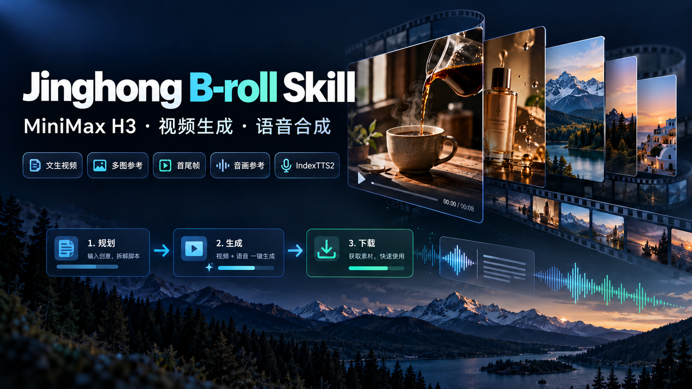

# Jinghong B-roll Skill：让 AI 帮你补齐视频画面

## 复制这段话，让 Codex 帮你安装

将下面的提示词复制到 Codex 对话中。Codex 需要具备下载项目和操作本地文件的权限；安装后按提示完成配置即可。此步骤不提交视频或配音生成任务。

```text
请从 https://github.com/Newdvn2025/jinghong-broll-skill 安装 skills/jinghong-broll 到我的 Codex 技能目录。安装后检查运行环境，并引导我配置 AutoDL，先不要提交生成任务。
```

安装完成后，按 Codex 的提示在本地配置 AutoDL token，再开始规划镜头。完整步骤见下方“第一次使用”。

口播写好了，却找不到合适的素材？这个 Skill 可以让 AI 根据你的文案规划 B-roll（口播中穿插的补充画面），通过 AutoDL Art 调用 MiniMax H3，批量生成、查询进度、下载并整理素材。也支持 IndexTTS2 参考音色配音。

你负责讲清楚想要的内容、挑选镜头；AI 负责写生成提示词、准备参数和处理任务。

## 能解决什么问题？

- **不知道该配什么画面**：根据口播找出适合补画面的部分，给出场景、动作和细节镜头。
- **逐条生成太费操作**：一次规划多个镜头，批量提交，自动查询和下载。
- **下载后素材难找**：按编号和中文标题命名，保存任务与文件对应关系。
- **需要不同生成方式**：文字生成、参考图生成、首尾帧转场、图像加音频参考都已接入。

这是调用 AutoDL Art 托管 API 的工具，不需要自己部署模型。Skill 分享与模型生成是两件事：调用平台生成仍需账户、对应接口的 token 和足够余额。实际费用以平台扣费为准，当前项目还没有单条成本实测记录。公告价格与费用边界见 [调用费用核查](docs/调用费用核查.md)。

## 第一次使用：按这五步开始

### 1. 安装 Skill

下载项目，将 `skills/jinghong-broll` 整个文件夹复制到 AI 助手的技能目录。里面必须保留 `SKILL.md`、`scripts`、`references` 和 `agents`。

Codex 的安装位置：

```text
~/.codex/skills/jinghong-broll/
```

安装后重新打开助手会话，输入：

> 使用 $jinghong-broll，介绍你能帮我做什么，并检查第一次使用还缺什么配置。先不要生成。

其他助手需要支持 SKILL.md，并允许运行本地 Python 脚本；具体安装目录按该助手说明操作。脚本需要 Python 3.10 或更高版本，只使用标准库，无需安装额外 Python 包。

### 2. 配置 AutoDL Art token

进入 [AutoDL Art](https://autodl.art)，准备账户余额和对应 ComfyUI 工作流 API 的 token。官方接入文档确认：打开 [令牌管理](https://autodl.art/large-model/tokens)，点击创建令牌，分组选择 **ComfyUI**。不要使用应用实例 API 的开发者 token。详见 [官方 ComfyUI API 文档](https://autodl.art/docs/comfyui_api/)。

在你自己的项目目录创建 `.env`，填入：

```dotenv
AUTODL_ART_TOKEN=替换成你自己的token
```

请在本地文件中填写真实值。随后告诉助手文件路径：

> 我的 AutoDL token 已放在当前项目的 .env 文件。调用时使用 --env-file 读取，不要显示 token。先检查配置，不提交任务。

也可以通过环境变量 `AUTODL_ART_TOKEN` 配置。项目附带 `.env.example` 占位示例，`.gitignore` 会忽略 `.env`；分享压缩包时仍需自己排除真实凭证文件。

### 3. 交给 AI 一段口播，先看方案

可以直接复制：

> 使用 $jinghong-broll，给下面这段口播补画面。用途是小红书，9:16 竖屏，写实风格。先规划 3 条镜头，每条 4 秒，告诉我对应哪句话、画面内容、需要什么参考素材以及生成方式。先不要提交付费任务。
>
> 口播：下班之后，我喜欢把手机放到一边，给自己冲一杯咖啡，再坐到窗边读几页书。

AI 应先给你可阅读的镜头方案，例如：手机放到桌面、冲咖啡的手部特写、窗边读书。你可以说“第二条改成倒咖啡”“不要露脸”“只保留两条”。

竖屏要选择该工作流已确认的竖屏参数。参考图模式已列出竖屏选项；官方 API 示例已使用 `480p竖` 文生视频参数，但完整分辨率枚举还没有补齐，助手应说明这一点并确定可用方案，不能直接把默认横屏当作竖屏。

### 4. 确认镜头后，再要求生成

> 按刚才确认的方案生成。使用 .env 中的 token，把清单和结果保存到当前项目的 broll输出/第一批。生成结束后告诉我成功几条、失败几条和文件位置。

AI 会把方案转成 JSON 清单、检查参数，然后提交 API、保存任务 ID、查询进度并下载结果。这个阶段会产生平台费用。等待时间取决于平台排队和工作流运行情况。

第一次建议只生成一条短镜头，确认接口、费用和效果，再批量生成。当前脚本没有费用估算或预算上限功能，仅在提示词里写“最多花五元”不能强制限制扣费。

### 5. 取素材，继续剪辑

完成后，你会得到：

```text
broll输出/第一批/
├── 请求Body/             # 各镜头提交的参数
├── 任务状态.json          # 任务 ID、状态、下载路径
└── 视频/
    ├── 01-手机放到桌面.mp4
    ├── 02-冲咖啡特写.mp4
    └── 03-窗边读书.mp4
```

配音任务保存到 `音频/`。把生成素材导入自己的剪辑软件，放到对应口播位置即可。这个 Skill 当前负责生成素材，尚未自动剪辑、加字幕或导出完整成片。

## 已支持的生成方式

| 你想做什么 | 需要提供什么 | 当前支持 |
| --- | --- | --- |
| 从零补一段画面 | 画面描述或口播 | 文生视频，1–15 秒 |
| 让人物、产品或场景参考图动起来 | 提示词和 1–6 张图片 | 参考图视频，1–15 秒；横竖屏选项 |
| 用更多图片做参考 | 提示词和 1–9 张图片 | 九图参考视频，1–12 秒；横屏、竖屏、方形 |
| 做 A 到 B 的转场 | 首帧、尾帧、变化描述 | 首尾帧视频，1–15 秒；横屏、竖屏、方形 |
| 综合图像和声音参考生成 | 提示词、1–6 张图、1–3 段音频 | 音画参考视频，1–15 秒 |
| 用参考音色读文案 | 文本、授权音色参考音频 | IndexTTS2 配音、情绪控制 |

图片支持 JPEG/PNG/WebP；视频音频参考支持 MP3/WAV/FLAC；配音参考支持 MP3/WAV。可以交给助手本地文件路径或网络 URL。参考图有助于连续性，但不保证每次都能保持人物一致。音频参考功能也尚未实测精确口型同步。

## 另外三个可以直接复制的指令

**产品图生成：**

> 使用 $jinghong-broll，把 assets/产品.png 作为参考，生成一条 5 秒的竖屏产品特写。产品放在木桌上，镜头缓慢靠近，保持产品外观。先给我看方案和参数。

**首尾帧转场：**

> 使用 $jinghong-broll，用 assets/起点.png 和 assets/终点.png 做一条 5 秒竖屏转场。希望通过前景遮挡完成变化。先规划，再等我确认生成。

**参考音色配音：**

> 使用 $jinghong-broll，用我授权的 assets/音色参考.wav 合成下面这段旁白，情绪平静自然。先检查文本与参数，不提交。文案：……

## 中断或失败了怎么办？

- **会话中断**：告诉助手“继续查询第一批已有任务，不要重新提交”，保留原清单和输出目录。
- **有镜头失败**：先看失败原因，再决定是否重新付费生成；不会自动重提失败任务。
- **想修改提示词重做**：使用新的批次目录，例如 `broll输出/第二批`。同名镜头在旧目录里会沿用已有任务。
- **成功但文件丢了**：目前没有自动补下载功能，让助手检查是否还能取回结果；平台结果链接可能过期。
- **找不到 token**：确认 `.env` 路径和变量名，调用脚本时传入 `--env-file`。

## 进阶：自己运行脚本

只检查参数和准备请求，不调用生成 API：

```bash
python3 skills/jinghong-broll/scripts/autodl_broll.py \
  skills/jinghong-broll/references/manifest_example.json \
  --output-dir broll输出/测试 --prepare-only
```

正式提交同一份示例清单：

```bash
python3 skills/jinghong-broll/scripts/autodl_broll.py \
  skills/jinghong-broll/references/manifest_example.json \
  --output-dir broll输出/测试 --env-file .env
```

每份清单使用一种工作流。视频和配音分批运行。更多参数见 [Skill 说明](skills/jinghong-broll/SKILL.md) 与 [API 参数笔记](skills/jinghong-broll/references/autodl_api.md)。

## 项目状态

2026-10-07：24 项本地参数测试通过。本项目尚未进行付费生成验证，当前平台价格和接口可用性需实测。代码采用 MIT 许可证；模型、平台服务及参考素材按各自许可和条款使用。当前仍待补齐 token 获取入口截图及实际费用案例。

